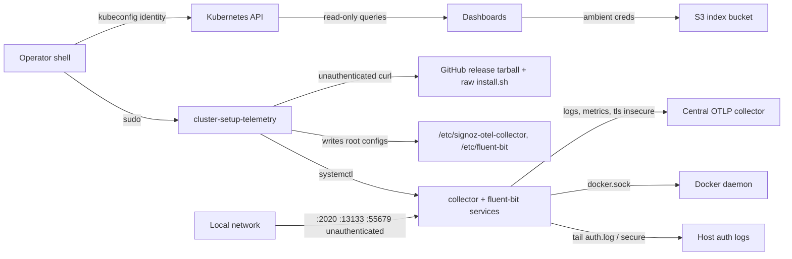

# Threat Model — cluster-tools

Living threat model for this package: what can go wrong, verified against the
code on `develop`. Counterpart to [PROJ-ARCH.md](PROJ-ARCH.md) ("how it works")
— assets and boundaries are derived there and from
[PROJ-LAYOUT.md](PROJ-LAYOUT.md), not restated here.

## Scope and posture

This is **operator tooling**, not a service. Nothing here listens on a port on
the operator's machine; there is no authn/authz code, no tenant boundary, and no
data store. Two very different surfaces share the repo:

1. **Six dashboards** (`cluster-status`, `-nodes`, `-resources`, `-helm`,
   `-layout`, `-manticore`) — read-only queries against the **ambient** kubectl
   context and, for Manticore, ambient AWS credentials. They run with whatever
   RBAC the invoking kubeconfig carries.
2. **`cluster-setup-telemetry`** — a root installer run **on a remote VM/EC2
   host**. It installs two systemd services, writes their configs, and opens
   listener sockets. This is where the real attack surface lives.

> Cluster-scope note: the Manticore dashboard targets the **`noizu`** cluster
> only. `gnp`/`jass`/`lacrosse` stacks are out of scope for this package and are
> documented from source, never executed.

## Trust boundaries

| Boundary | Crossing |
|----------|----------|
| operator shell → cluster API | `kubectl`/`helm` with the operator's kubeconfig identity |
| operator shell → target host root | `cluster-setup-telemetry` run via sudo; takes over `/etc`, `/opt`, systemd |
| target host → package network | unauthenticated `curl` fetches of `signoz-otel-collector` tarball and Fluent Bit `install.sh` |
| target host → central collector | OTLP gRPC, `tls.insecure: true`, no client auth |
| host services → local network | Fluent Bit HTTP `0.0.0.0:2020`, collector `zpages 0.0.0.0:55679`, `health_check 0.0.0.0:13133` |
| collector process → Docker daemon | service user in `docker` group; `docker_stats` reads `/var/run/docker.sock` |
| target host → S3 / DBs | `aws s3` ambient credentials; PG/MySQL monitoring users |

## Attack surface

## Vulnerability register

| ID | Severity | STRIDE | Component | Finding | Status |
|----|----------|--------|-----------|---------|--------|
| T-001 | High | Tampering | `install_fluentbit` (Debian) | `curl -fsSL https://raw.githubusercontent.com/fluent/fluent-bit/master/install.sh \| sh` — unpinned branch-head script executed as root with no integrity check. The RHEL path is better (`gpgcheck=1` repo). | Open |
| T-002 | High | Tampering | `install_otelcol` | Collector tarball fetched from a GitHub release and installed as a root service with **no checksum or signature verification**; only the version is pinned. | Open |
| T-003 | High | Information disclosure | `generate_otelcol_config` | PG/MySQL monitor passwords are written in plaintext to `/etc/signoz-otel-collector/config.yaml`. Neither the directory (`mkdir -p`) nor the file is chmod/chowned, so default umask leaves it readable by any local user. | Open |
| T-004 | High | Information disclosure | `exporters.otlp`, PG/MySQL receivers | `tls: insecure: true` on the export leg and both DB receivers. Exported payloads include auth-log lines (usernames, source IPs) and host/DB telemetry, in cleartext; the central collector is not authenticated. | Open |
| T-005 | Medium | Information disclosure | Fluent Bit `[SERVICE]` | `HTTP_Server On`, `HTTP_Listen 0.0.0.0`, port 2020 — unauthenticated metrics/state endpoint reachable from any host on the segment. | Open |
| T-006 | Medium | Information disclosure | collector `extensions` | `zpages` on `0.0.0.0:55679` serves live span/trace data; `health_check` on `0.0.0.0:13133`. Both unauthenticated and bound to all interfaces. | Open |
| T-007 | Medium | Elevation of privilege | `configure_services` | When Docker is detected the collector user joins the `docker` group — root-equivalent on the host (socket access), in addition to the `docker_stats` receiver reading `/var/run/docker.sock`. | Partial (accepted for container metrics) |
| T-008 | Medium | Tampering | `HOSTNAME_LABEL`, `OTEL_ENDPOINT` | Both positional args are interpolated verbatim into root-owned YAML/INI heredocs with no validation or escaping; a value containing newlines injects extra config keys (e.g. an additional exporter). Precondition: caller already runs the installer as root. | Open |
| T-009 | Medium | Elevation of privilege / Spoofing | all dashboards | Tools have no identity of their own: they act with the ambient kubeconfig (in practice cluster-wide read, often admin). Nothing enforces read-only, and anyone who can run the installed scripts inherits that identity. | Accepted (design) |
| T-010 | Low | Tampering | `cluster-manticore` | `${K8_MANTICORE_READER_POD}` is passed unquoted into `kubectl exec`; word splitting/globbing lets env contents inject extra `kubectl` arguments. Env is operator-controlled. | Open (low) |
| T-011 | Low | Information disclosure | `cluster-manticore` | `aws s3 cp/ls` runs on ambient AWS credentials with no narrowing to the index bucket/prefix (read-only calls). | Accepted |
| T-012 | Low | Repudiation | whole installer | No audit trail of who ran the installer or from where; the only forensic artifact is `<config>.bak.<epoch>` backups taken immediately before overwrite. | Accepted |
| T-013 | Low | Denial of service | `check_connectivity` | Unreachable collector blocks up to 30 minutes (3-minute retries) before failing; under automation this stalls a provisioning pipeline rather than failing fast. | Accepted |
| T-014 | Low | Tampering | `install_otelcol` | `trap "rm -rf $tmp_dir" EXIT` interpolates an unquoted variable; the value comes from `mktemp -d`, so it is not attacker-controlled. | Accepted |
| T-015 | Medium | Information disclosure | `configure_services` | Service users join `adm` + `systemd-journal` and tail `/var/log/auth.log`, `/var/log/secure`, and Docker container logs — host-wide log read is the intended capability, but everything read leaves the host in cleartext (compounds T-004). | Partial (capability intended; exposure via T-004) |

## Mitigation coverage

Register status: **8 open · 2 partial · 5 accepted** of 15 entries.

Mitigations that exist and where they live:

| Mitigation | Covers | Where |
|------------|--------|-------|
| Collector version pinned to `telemetry.otelcol_version` (`0.129.12` default) | T-002 (reduces drift, no integrity) | `install_otelcol` |
| GPG-checked package repo on RHEL (`gpgcheck=1`, signed key) | T-001 on RHEL only | `install_fluentbit` |
| Dedicated no-login service user `signoz-otel-collector` | least privilege for the collector process (weak vs T-007) | `install_otelcol` |
| Config backups `*.bak.<epoch>` before every overwrite | T-012 (rollback, not attribution) | `generate_*`, `check_existing_install` |
| Non-interactive overwrite refusal without `FORCE_REINSTALL=1` | accidental reinstall / silent config loss | `check_existing_install` |
| `set -euo pipefail` in every tool | fail-fast on partial writes | all `bin/*` |

## Residual risk

Accepted for the current deployment: these run on hosts the team already owns,
inside one perimeter, invoked by privileged operators — so T-009/T-011/T-012/T-013
are cost-of-doing-business rather than open bugs. What is **not** acceptable
silently: T-001/T-002 (root code from an unverified fetch), T-003 (world-readable
DB credentials), and T-004/T-005/T-006 (cleartext export plus unauthenticated
listeners). Those are cheap to close and should be treated as fixes, not
acceptances:

- T-003 — `install -m 600 -o root` on the generated collector config.
- T-005/T-006 — bind Fluent Bit HTTP and collector extensions to `127.0.0.1`.
- T-004 — `tls.insecure: false` with a CA on the export leg; TLS on DB receivers.
- T-001/T-002 — pin the Fluent Bit install script to a release tag and verify a
  published checksum for the collector tarball.

## Related docs

- Components, data flow, listener inventory: [PROJ-ARCH.md](PROJ-ARCH.md)
- Generated config shapes and env contracts: [PROJ-SCHEMA.md](PROJ-SCHEMA.md)
- Where each boundary-crossing script lives: [PROJ-LAYOUT.md](PROJ-LAYOUT.md)
